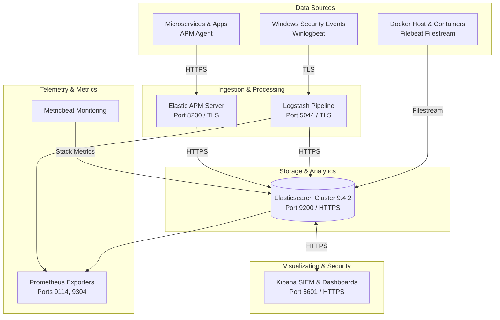

# Enterprise SIEM & Elastic Observability Lab

<p align="center">
  
  
  
  
  
</p>

**Author & Maintainer:** **Nirmal Manoj**  
**Technology Stack:** Elasticsearch 9.4.2, Kibana 9.4.2, Logstash 9.4.2, APM Server 9.4.2, Filebeat, Metricbeat, Docker Compose v2, TLS/PKI, Bash/PowerShell.

---

## 📌 Executive Summary

The **Enterprise SIEM & Elastic Observability Lab** is a containerized, production-grade security monitoring platform and logging ecosystem. Engineered on top of Elastic Stack 9.4.2, this lab provides centralized security event collection, threat detection, performance telemetry, and application tracing with end-to-end TLS encryption and Keystore credential management.

It is structured for immediate deployment in SOC simulation environments, threat hunting laboratories, and containerized workload monitoring.

---

## 🏗️ Architecture Overview



### Component Details

| Service | Port | Protocol | Purpose |
| :--- | :--- | :--- | :--- |
| **Elasticsearch** | `9200`, `9300` | HTTPS / TLS | Distributed search & SIEM document datastore |
| **Kibana** | `5601` | HTTPS | SOC Analyst dashboard, SIEM alert manager, visualizations |
| **Logstash** | `5044`, `9600` | TCP / TLS | Dynamic ingestion pipeline, event enrichment, Beats receiver |
| **APM Server** | `8200` | HTTPS | Application performance monitoring, distributed tracing |
| **Filebeat** | Internal | Docker Socket | Automated Docker container log discovery using filestream inputs |
| **Metricbeat** | Internal | HTTPS | Cluster self-monitoring & metric collection (ES 9 architecture) |
| **ES Exporter** | `9114` | HTTP | Prometheus metrics endpoint for Elasticsearch health |
| **Logstash Exporter**| `9304` | HTTP | Prometheus metrics endpoint for Logstash pipeline health |

---

## 🚀 Quick Start Guide

All deployment manifests and scripts reside in the [`elastdocker-main/`](elastdocker-main/) directory.

### Prerequisites
- **Docker Engine** (20.05+) and **Docker Compose** (v2+)
- **System Memory**: Minimum 4GB RAM allocated to Docker Desktop/Engine
- **Windows / Linux / macOS** compatible

### Step 1: Navigate to Stack Directory & Configure Environment
```bash
cd elastdocker-main
# Create local .env from example template (if not already present):
cp .env.example .env
```

### Step 2: Initialize Keystore & TLS Certificates
Generate the self-signed Certificate Authority (CA), service certificates, and encrypted Elasticsearch keystores:
```bash
# Direct Docker Compose:
docker compose -f docker-compose.setup.yml run --rm setup-certs
docker compose -f docker-compose.setup.yml run --rm setup-keystore

# OR using mise task runner (if installed):
mise run elk:setup
```

### Step 3: Launch Core Elastic Stack
```bash
# Direct Docker Compose:
docker compose up -d

# OR using mise:
mise run elk
```

### Step 4: Access Kibana Security Interface
Open your browser to:
- **URL:** [https://localhost:5601](https://localhost:5601)
- **Username:** `elastic`
- **Password:** `changeme` *(configurable in `.env`)*

*(Note: Because self-signed certificates are generated for local lab security, accept the browser certificate warning on first visit).*

---

## 🛡️ SIEM & Threat Hunting Capabilities

- **Elastic Security & SIEM App**: Out-of-the-box support for MITRE ATT&CK detection rules, timeline analysis, and security alert triage.
- **Windows Security Event Ingestion**: Direct ingestion pathway for `Winlogbeat` forwarding Windows Security Event IDs (logon events, privilege escalation, process creation).
- **Automated Container Log Discovery**: Filebeat filestream prospectors automatically discover running Docker containers and parse logs without manual configuration.
- **Enterprise TLS Everywhere**: Inter-node transport (port 9300), REST APIs (port 9200), Logstash pipelines (port 5044), and Kibana web UI (port 5601) are strictly encrypted with TLS.

---

## 🛠️ Management Commands

Inside [`elastdocker-main/`](elastdocker-main/):

| Goal | Docker Compose Command | Mise Command (Alternative) |
| :--- | :--- | :--- |
| **Start Core Stack** | `docker compose up -d` | `mise run elk` |
| **Start with Monitoring** | `docker compose -f docker-compose.yml -f docker-compose.monitor.yml up -d` | `mise run elk:monitoring` |
| **Collect Container Logs** | `docker compose -f docker-compose.yml -f docker-compose.logs.yml up -d filebeat` | `mise run elk:collect-docker-logs` |
| **Start Full Suite** | `docker compose -f docker-compose.yml -f docker-compose.monitor.yml -f docker-compose.nodes.yml -f docker-compose.logs.yml up -d` | `mise run elk:all` |
| **View Logs** | `docker compose logs -f [service]` | `mise run elk:logs [service]` |
| **Stop Stack** | `docker compose stop` | `mise run elk:stop` |
| **Tear Down** | `docker compose down` | `mise run elk:down` |

---

## 📜 License & Attribution

This project is licensed under the [MIT License](elastdocker-main/LICENSE).

- **Portions Copyright (c) 2026 Nirmal Manoj** (Portfolio modifications, SIEM telemetry integration, and maintenance)
- **Portions Copyright (c) 2022 Sherif Abdel-Naby** (Original Elastdocker base architecture)

### Acknowledgments & Inherited Foundation
This project builds upon the foundational Docker Compose architecture originally created by Sherif Abdel-Naby in the open-source *Elastdocker* project. Key modifications and engineering enhancements maintained in this repository include:
1. **Elastic Stack 9.4.2 Upgrade**: Adaptation of service configurations to Elastic 9 specifications.
2. **Modernized Beats Pipelines**: Replacement of deprecated `container` inputs with `filestream` parsers.
3. **External Metricbeat Monitoring**: Migration away from legacy internal monitoring to Metricbeat-driven telemetry.
4. **SIEM Telemetry & Threat Hunting**: Customizations for security event processing and multi-platform log forwarding.
5. **Cross-Platform Compose Workflows**: Native Windows and Linux support without external dependencies.
